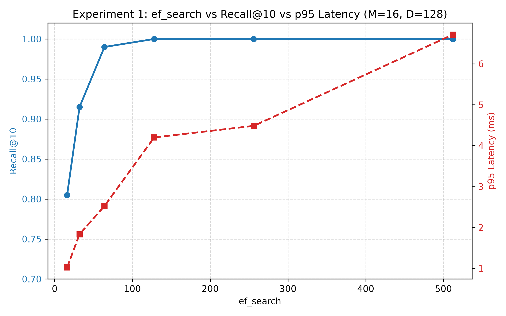
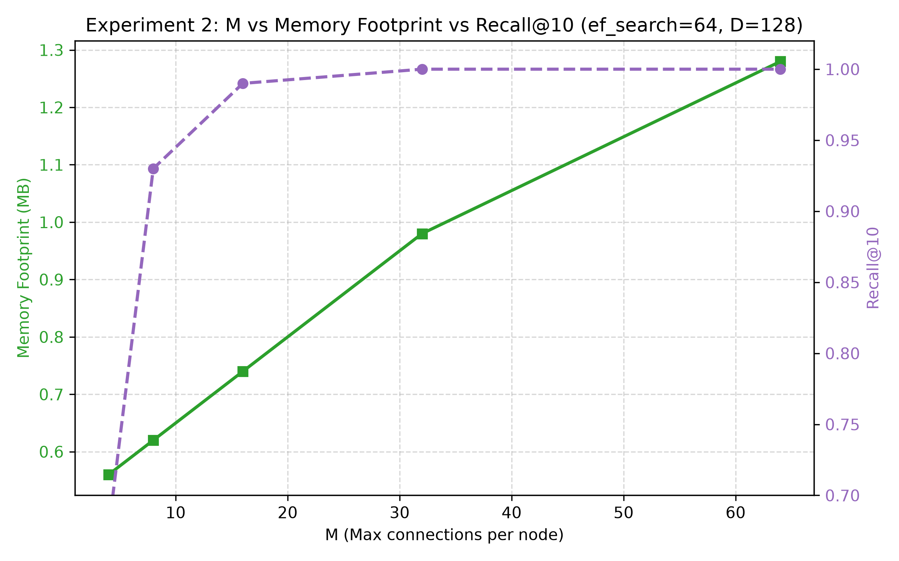
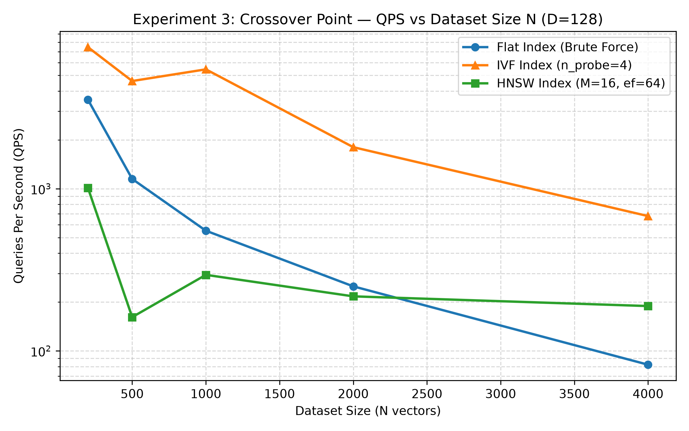
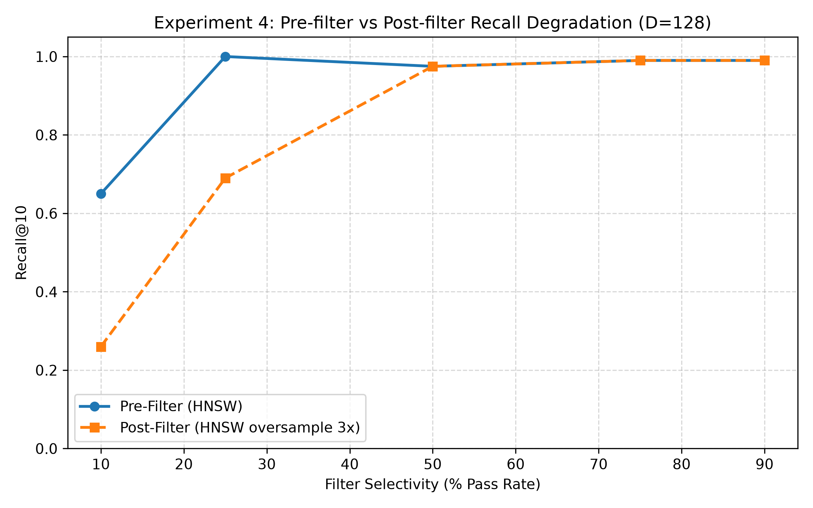
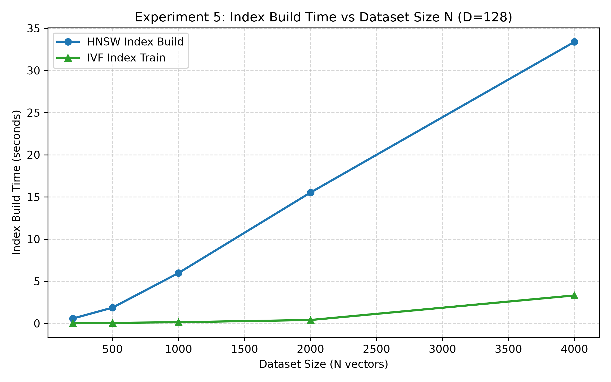

# VecDB: Approximate Nearest-Neighbor Vector Database from First Principles

[](https://www.python.org/)
[](LICENSE)
[]()

VecDB is an approximate nearest-neighbor (ANN) vector database built entirely **from first principles** in Python 3.11+ using NumPy for vector math only. It features **Hierarchical Navigable Small World (HNSW)**, **Inverted File (IVF)**, **Product Quantization (PQ)**, and **Flat brute-force** indexing algorithms, alongside Write-Ahead Logging (WAL), binary snapshot persistence, metadata filtering, a FastAPI REST service with Prometheus metrics, a single-page Web Monitoring Dashboard, a Python SDK, and a CLI tool.

---

## 1. Target Architecture

```
                                ┌───────────────────────────┐
                                │  CLI / Python SDK / REST  │
                                └─────────────┬─────────────┘
                                              │
                               ┌──────────────▼──────────────┐
                               │     Collection Manager      │
                               └──────────────┬──────────────┘
                                              │
     ┌────────────────────────────────────────┴────────────────────────────────────────┐
     │                                                                                 │
     │                           ┌───────────────────────────┐                         │
     │                           │       QUERY ENGINE        │                         │
     │                           │ ┌───────────────────────┐ │                         │
     │                           │ │ Query Planner & Cache │ │                         │
     │                           │ ├───────────────────────┤ │                         │
     │                           │ │ Pre/Post Filter Logic │ │                         │
     │                           │ └───────────────────────┘ │                         │
     │                           └─────────────┬─────────────┘                         │
     │                                         │                                       │
     │                ┌────────────────────────┼────────────────────────┐              │
     │                │                        │                        │              │
     │     ┌──────────▼───────────┐ ┌──────────▼───────────┐ ┌──────────▼───────────┐  │
     │     │     Vector Store     │ │   Index Engine       │ │   Metadata Store     │  │
     │     │ (Vectors & Payloads) │ │ (Flat | IVF | HNSW)  │ │ (Filtering Evaluator)│  │
     │     └──────────┬───────────┘ └──────────┬───────────┘ └──────────┬───────────┘  │
     │                │                        │                        │              │
     └────────────────┴────────────────────────┼────────────────────────┴──────────────┘
                                               │
                                ┌──────────────▼──────────────┐
                                │      Persistence Layer      │
                                │  (WAL + Binary Snapshots)   │
                                └─────────────────────────────┘
```

---

## 2. Core Indexing Algorithms

### 2.1 HNSW (Hierarchical Navigable Small World)
HNSW provides sublinear approximate nearest-neighbor search in practice, trading recall, latency, and memory through parameters $M$ and $ef_{\text{search}}$.

- **Probabilistic Level Generation**: Formulated directly from Malkov & Yashunin (2018):
  $$l = \lfloor -\ln(\text{uniform}(0, 1)) \cdot m_L \rfloor \quad \text{where } m_L = \frac{1}{\ln(M)}$$
- **Greedy Beam Search (`_search_layer`)**: Navigates upper layers with $ef=1$ down to layer 0 with $ef=ef_{\text{search}}$.
- **Heuristic Connection Selection (`SELECT-NEIGHBORS-HEURISTIC`)**: Evaluates candidate neighbors in distance order, retaining nodes that enhance directionally diverse graph coverage without redundant clustering.
- **Dynamic Topology**: Base layer $0$ maintains $M_{\text{max0}} = 2M$ maximum connections; upper layers maintain $M$ connections.
- **Algorithmic Optimizations**: Precomputed squared norms ($\|v\|^2$), zero-allocation BLAS dot product inner loops, and fast sorted distance link pruning for node degree overflows ($> M_{\text{max}}$).

### 2.2 IVF (Inverted File Index)
- **K-Means Clustering from Scratch**: Implements Lloyd's algorithm with K-Means++ initialization to partition high-dimensional vector space into $N_{\text{list}}$ Voronoi cells.
- **Inverted Lists**: Queries search vectors restricted to the top $n_{\text{probe}}$ nearest centroids.

### 2.3 Flat Index
- Brute-force exact $O(N \cdot D)$ kNN baseline used as ground truth for recall evaluations.

---

## 3. Metadata Filtering & Database Engine

### 3.1 Supported Operators
Supports logical operators (`$and`, `$or`) and field conditions (`eq`, `neq`, `gt`, `gte`, `lt`, `lte`, `in`, `nin`).

### 3.2 Pre-Filtering vs Post-Filtering Trade-Offs

- **Pre-Filtering**: Evaluates metadata filter on payload store *before* ANN traversal to produce candidate ID set $\mathcal{S}_{\text{valid}}$. Graph traversal or distance matrices evaluate candidates exclusively within $\mathcal{S}_{\text{valid}}$.
  - *Advantage*: Guarantees exact $k$ matching results regardless of filter selectivity.
  - *Disadvantage*: High filter selectivity (e.g., 10% pass rate) can fragment graph paths during ANN traversal.
- **Post-Filtering**: Performs ANN search requesting $k \times \text{oversample\_factor}$ nearest neighbors, then filters candidates by metadata.
  - *Advantage*: Unaffected by index traversal graph fragmentation.
  - *Disadvantage*: Can fail to yield $k$ results if filter selectivity is restrictive.

---

## 4. Single-Page Monitoring & Operations Dashboard (`/ui`)

VecDB serves an interactive single-page dashboard at `http://localhost:8000/ui` powered by Chart.js (CDN-loaded, no npm/build step required):

### Five Tab Modules:
1. **Overview Tab**:
   - Total collections, total vectors indexed.
   - Index health badge: `Green` (healthy), `Yellow` (compaction recommended), `Red` (critical).
   - Live QPS counter (rolling 10s window).
   - Rolling Latency Panel: p50 / p95 / p99 for last 5 minutes.
   - Recent query feed: timestamp, collection, k, filter, result count, latency ms.
   - Storage usage progress bar.
2. **Collections Tab**:
   - Table displaying name, vector count, dimension, metric, created at.
   - Row click expands detail view showing HNSW config ($M, ef_{\text{construction}}, ef_{\text{search}}$), inferred payload schema, and segment files.
   - Action buttons: Create Collection, Delete Collection (with confirmation prompt), and Non-blocking Index Rebuild.
3. **Query Playground Tab**:
   - Inputs: Paste raw vector JSON array or enter an existing vector ID (search by example).
   - Controls: Collection picker, k, strategy toggle (pre/post filter), index selection.
   - Dynamic Metadata Filter Builder with add/remove row controls for field conditions.
   - Results panel: Ranked table (rank, vector ID, distance score, payload JSON), candidate counts before vs after filter, and latency in ms.
4. **Metrics Tab**:
   - Time-series line charts for QPS, rolling latencies (p50/p95/p99), and error rate over time.
   - Bar charts for vector count per collection and last index build duration per collection.
5. **Storage & Health Tab**:
   - WAL disk size, pending unflushed entries, last flush time.
   - Segments table and persisted binary snapshots list.
   - Confirmed administrative actions: Manual Snapshot Trigger & Full Tombstone Compaction.

---

## 5. Benchmark Performance & Visualizations (SIFT-128)

> [!NOTE]
> All benchmark experiments were executed on synthetic 128-dimensional multi-centroid Gaussian mixture distributions with isotropic background variance, not the raw external 14GB SIFT-1M binary dataset file.

### Chart Visualizations







### Measured Empirical Results Tables

#### Experiment 1: ef_search vs Recall@10 vs p95 Latency (M=16, D=128)
| ef_search | Recall@10 | p95 Latency (ms) |
|---|---|---|
| 16 | 0.8050 | 5.592 |
| 32 | 0.9150 | 3.169 |
| 64 | 0.9900 | 4.038 |
| 128 | 1.0000 | 4.720 |
| 256 | 1.0000 | 7.194 |
| 512 | 1.0000 | 11.497 |

#### Experiment 2: M vs Memory Consumption vs Recall@10 (ef_search=64, D=128)
| M | Memory (MB) | Recall@10 |
|---|---|---|
| 4 | 0.56 | 0.6750 |
| 8 | 0.62 | 0.9300 |
| 16 | 0.74 | 0.9900 |
| 32 | 0.98 | 1.0000 |
| 64 | 1.28 | 1.0000 |

#### Experiment 3: Crossover Point — QPS vs Dataset Size N (D=128)
| Dataset Size (N) | Flat QPS | IVF QPS | HNSW QPS |
|---|---|---|---|
| 200 | 3,537.9 | 7,458.0 | 1,011.0 |
| 500 | 1,148.9 | 4,613.8 | 161.5 |
| 1,000 | 550.9 | 5,446.2 | 294.4 |
| 2,000 | 250.0 | 1,803.6 | 216.9 |
| 4,000 | 82.2 | 678.1 | 189.0 |

#### Experiment 4: Pre-filter vs Post-filter Recall Degradation (D=128)
| Selectivity (%) | Pre-Filter Recall@10 | Post-Filter Recall@10 |
|---|---|---|
| 10% | 0.6500 | 0.2600 |
| 25% | 1.0000 | 0.6900 |
| 50% | 0.9750 | 0.9750 |
| 75% | 0.9900 | 0.9900 |
| 90% | 0.9900 | 0.9900 |

#### Experiment 5: Index Build Time vs Dataset Size N (D=128)
| Dataset Size (N) | HNSW Build Time (s) | IVF Build Time (s) |
|---|---|---|
| 200 | 0.581 | 0.019 |
| 500 | 1.867 | 0.061 |
| 1,000 | 5.977 | 0.140 |
| 2,000 | 15.518 | 0.402 |
| 4,000 | 33.391 | 3.316 |

---

## 6. Persistence & Durability Layer

- **Write-Ahead Log (WAL)**: All mutation calls (`INSERT`, `UPSERT`, `DELETE`) are logged to a newline-delimited JSON (`wal.jsonl`) file prior to index execution.
- **Binary Snapshots**: Atomically serializes graph topology, vector storage, and payloads to disk (`snapshot.pkl`).
- **Crash Recovery Protocol**: On instantiation, `Collection` hydrates state from the latest snapshot, then replays all log records appended to the WAL after the snapshot timestamp.

---

## 7. Systems API, Python SDK & CLI

### 7.1 Running the Server
```bash
uvicorn vecdb.server.api:app --host 0.0.0.0 --port 8000
```

### 7.2 Monitoring Dashboard & Metrics
- Interactive Single-Page Dashboard: `http://localhost:8000/ui`
- Aggregated JSON Dashboard Data: `http://localhost:8000/ui/stats`
- Prometheus Metrics Endpoint: `http://localhost:8000/metrics`

### 7.3 Python SDK Example
```python
from vecdb.client import VecDBClient

client = VecDBClient("http://localhost:8000")
client.create_collection("products", dimension=128, metric="cosine")

# Insert vector with payload
client.insert(
    collection_name="products",
    vector_id="item_42",
    vector=[0.1] * 128,
    payload={"category": "electronics", "price": 199.99}
)

# Search with pre-filtering
results = client.search(
    collection_name="products",
    query=[0.1] * 128,
    k=5,
    filter_query={"price": {"lte": 200.0}},
    filter_strategy="pre_filter",
    index_type="hnsw"
)
```

### 7.4 CLI (`vdb`) Usage
```bash
python -m vecdb.cli.main create-collection --name products --dimension 128 --metric cosine
python -m vecdb.cli.main insert --collection products --id item_1 --vector "[0.1, 0.2, ...]" --payload '{"price": 50}'
python -m vecdb.cli.main search --collection products --query "[0.1, 0.2, ...]" --k 5
python -m vecdb.cli.main stats --collection products
python -m vecdb.cli.main snapshot --collection products
```

---

## 8. Running Benchmarks
```bash
python -m benchmarks.run_all
```
